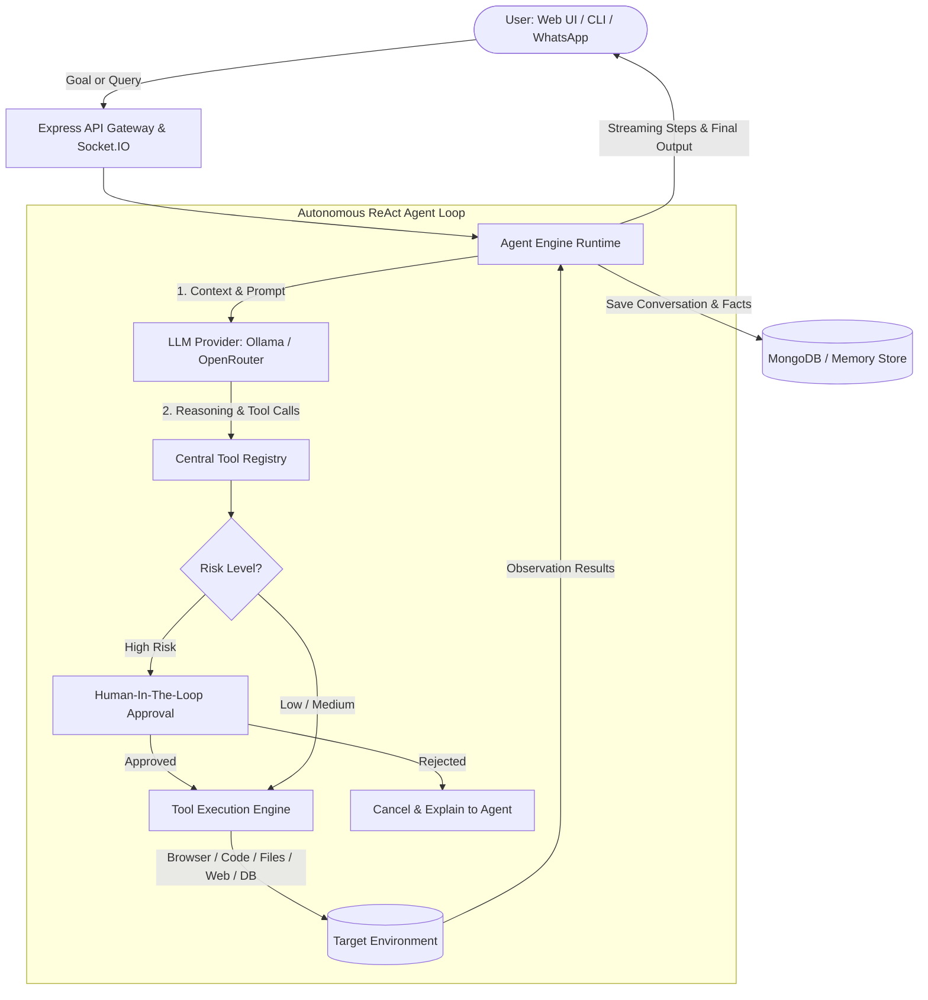

# Nova AI — Autonomous Agentic Assistant & Automation Platform

[](https://www.typescriptlang.org/)
[](https://nodejs.org/)
[](https://expressjs.com/)
[](https://react.dev/)
[](https://vitejs.dev/)
[](https://tailwindcss.com/)
[](https://ollama.com/)
[](https://playwright.dev/)
[](https://socket.io/)
[](https://opensource.org/licenses/MIT)

**Nova AI** is an extensible, full-stack, production-ready **autonomous Agentic AI assistant**. Unlike simple question-and-answer chatbots, Nova acts as an intelligent digital coworker: it breaks down complex human goals into actionable plans, interacts with the real world using specialized tools, automates web browsers, executes sandboxed code, integrates with workplace apps, and consults humans when sensitive actions require permission.

Nova works **100% locally with private LLMs via Ollama** (e.g., Qwen 2.5 7B, Llama 3.1) and also supports **cloud models via OpenRouter** (Claude 3.5 Sonnet, GPT-4o, DeepSeek, etc.).

---

## 📑 Table of Contents

- [Why Nova?](#-why-nova)
- [Key Features](#-key-features)
- [System Architecture](#-system-architecture)
- [Curated Bot Personas](#-curated-bot-personas)
- [Tools Ecosystem](#-tools-ecosystem)
- [Integrations Hub](#-integrations-hub)
- [Monorepo Structure](#-monorepo-structure)
- [Getting Started](#-getting-started)
  - [Prerequisites](#1-prerequisites)
  - [Installation & Build](#2-installation--build)
  - [Configuration](#3-configuration)
  - [Running Nova](#4-running-nova)
  - [Interactive Terminal CLI](#5-interactive-terminal-cli)
- [Environment Variables](#-environment-variables)
- [API Reference](#-api-reference)
- [Security & Risk Governance (HITL)](#-security--risk-governance-hitl)
- [Running Tests](#-running-tests)
- [License](#-license)

---

## 🌟 Why Nova?

Traditional conversational bots are limited to text in and text out. When you ask them to do real work—such as researching competitors, testing a web page, managing your calendar, or scraping data—they can only describe what *you* should do.

Nova changes that:
1. **Goal-Driven Autonomy:** You state a goal in plain English, and Nova plans the steps needed to accomplish it.
2. **Real Hands in the Real World:** Nova reads and writes files, searches the live internet, controls a real headless or visual browser via Playwright, and runs safe code.
3. **Safety by Design (Human-In-The-Loop):** Sensitive actions (deleting data, posting updates, running arbitrary code) require explicit user approval before execution.
4. **Data Privacy First:** Run entirely on your local machine using Ollama with zero external API calls or subscription requirements.
5. **Zero-Setup Database:** Built-in MongoDB with automatic in-memory fallback (`mongodb-memory-server`), letting you run the entire stack immediately without configuring a database server.

---

## ⚡ Key Features

| Feature | Description |
|---|---|
| **Autonomous ReAct Agent Loop** | Iterative **Reason + Act + Observe** execution loop powered by strict Zod schema validation. |
| **Dual LLM Engine** | Seamless switching between local Ollama models (Qwen 2.5, Llama 3) and 100+ cloud models via OpenRouter. |
| **Playwright Browser Automation** | Full browser control: navigation, form filling, clicking, screenshot capture, DOM scraping, and live streaming previews. |
| **Sandboxed Code Execution** | Safely evaluates JavaScript and TypeScript logic in an isolated runtime and returns formatted output. |
| **Curated Bot Personas** | Switch between specialized personas: **Nova Core**, **Nova TaskMaster**, **Nova Scout**, and **Nova Scribe**. |
| **Multi-Channel Integrations** | Native connectors for **WhatsApp**, **GitHub**, **Notion**, **Gmail**, **Google Calendar**, **Slack**, **Discord**, and **Telegram**. |
| **Live WebSocket Streaming** | Real-time token streaming, tool call execution events, plan step tracking, and browser screenshots over Socket.IO. |
| **Multi-Tier Memory System** | Working session memory, conversation history, and persistent cross-session knowledge storage. |
| **Voice Interface** | Browser-native Speech-to-Text (STT) input and Text-to-Speech (TTS) response playback with waveform visualizers. |
| **Modern Web Dashboard** | Polished React 19 + Tailwind CSS desktop-grade UI with dark/light themes, task boards, schedule managers, and analytics. |

---

## 🏗️ System Architecture

Nova combines an autonomous planning engine, a centralized tool registry, and real-time streaming communication:



### The ReAct Execution Cycle
1. **Ingest Goal:** Understands the user's objective and retrieves relevant saved memories.
2. **Formulate Plan:** The model analyzes the goal, reviews available tools and their Zod schemas, and decides the next action.
3. **Safety Gate:** Evaluates the risk tier (LOW, MEDIUM, HIGH). High-risk actions pause execution and await user confirmation.
4. **Execute Tool:** Runs the selected tool with typed, validated arguments.
5. **Observe & Iterate:** The tool output is fed back into the agent context as an observation. The cycle repeats until the goal is solved.
6. **Synthesize Final Response:** Presents a clean, grounded, human-readable summary without leaking internal JSON payloads.

---

## 🤖 Curated Bot Personas

Nova features pre-configured bot personas tailored for specific workflows. Each persona has its own system prompt, scoped tool permissions, default tone, and quick routines:

| Persona | Role | Primary Tools | Suggested Routines |
|---|---|---|---|
| **Nova Core** 🌟 | General omni-assistant & daily co-pilot | Full tool suite: Files, Math, Web, Browser, Tasks | *Daily Overview*, *Quick Math & Time Zone* |
| **Nova TaskMaster** 📋 | Executive task architect & agenda planner | Tasks, Reminders, Schedules, DateTime, Math | *Morning Standup Briefing*, *Backlog Triage*, *Evening Review* |
| **Nova Scout** 🔍 | Web researcher & live intelligence analyst | Web Search, Page Fetcher, Playwright, Code Runner | *Tech & AI Trend Radar*, *Deep Fact Check*, *Article Distiller* |
| **Nova Scribe** ✍️ | Executive drafter & communication specialist | Memory Store, Task Management, DateTime | *Draft Team Standup*, *Meeting Prep Briefing*, *Action Item Extractor* |

> **Customization:** Users can fine-tune any bot's tone (Concise, Friendly, Formal, Analytical), adjust temperature, customize system instructions, and schedule automated recurring routines directly from the UI.

---

## 🧰 Tools Ecosystem

Nova's capabilities are powered by a centralized, extensible `ToolRegistry`. Every tool is strictly typed using Zod:

### 1. System & Utility Tools
- `get_current_time`: Fetches current system time, UTC offset, and date context.
- `calculate`: Evaluates complex mathematical expressions using `mathjs`.
- `list_files`: Inspects files and folders within designated workspaces.
- `read_file`: Reads text content from local workspace documents.
- `create_file`: Writes structured content and reports to files.

### 2. Productivity Tools
- `create_task`, `list_tasks`, `update_task`, `complete_task`, `delete_task`: Full lifecycle task backlog management.
- `create_reminder`, `list_reminders`, `cancel_reminder`: Time-based alerts and notifications.
- `save_memory`, `recall_memory`, `list_memories`: Long-term persistent fact storage and contextual recall.
- `create_schedule`, `list_schedules`, `cancel_schedule`: Automated cron-based recurring agent execution.

### 3. Research Tools
- `web_search`: Live search across the web with snippet and source extraction.
- `fetch_web_page`: Fetches web pages, strips HTML boilerplate, and extracts clean markdown for LLM comprehension.

### 4. Browser Automation Tools (Playwright)
- `open_browser` / `close_browser`: Launches and manages headless or visible browser sessions.
- `navigate_to`: Navigates to any URL with page load synchronization.
- `click_element` / `type_into` / `hover_element`: Interacts with inputs, buttons, and UI controls.
- `extract_page_content`: Scrapes structured text and headings from active pages.
- `take_screenshot`: Captures full-page or element screenshots, streamed directly to the frontend.
- `scroll_page` / `wait_for_selector`: Handles dynamic, infinite-scroll, and SPA pages.

### 5. Sandboxed Code Execution
- `execute_code`: Executes sandboxed JavaScript/TypeScript logic to process data, parse JSON, or compute results safely.

---

## 🔌 Integrations Hub

Nova connects with the services you use every day:

- **WhatsApp:** Connect your WhatsApp via QR code pairing using Baileys to receive summaries, manage tasks, or chat with Nova directly from your phone.
- **GitHub:** Query repositories, inspect files, check pull requests, and list issues.
- **Notion:** Create pages, append blocks, and query structured databases.
- **Google Calendar & Gmail:** View scheduled meetings and draft email correspondence.
- **Slack & Discord:** Post automated updates, run alerts, and forward briefings to channels.
- **Telegram:** Send notifications and interact via Telegram bot webhooks.
- **Custom REST:** Configure custom HTTP endpoints for external webhooks and services.

---

## 📁 Monorepo Structure

```text
nova/
├── client/                     # Frontend Application (React 19 + Vite + Tailwind CSS)
│   ├── src/
│   │   ├── components/         # Chat, Voice, Analytics, BotPicker, BrowserPreview
│   │   ├── hooks/              # Custom React hooks (audio, socket, auth)
│   │   ├── services/           # API and WebSocket client services
│   │   └── App.tsx             # Main dashboard shell and view routing
│   └── package.json
│
├── server/                     # Backend API & Agent Engine (Express + TypeScript)
│   ├── src/
│   │   ├── agents/             # AgentEngine runtime, ReAct loop, permission gates
│   │   ├── tools/              # ToolRegistry, System, Productivity, Browser, Code
│   │   ├── llm/                # Ollama & OpenRouter LLM providers + model catalog
│   │   ├── integrations/       # Connectors for WhatsApp, GitHub, Notion, Slack, etc.
│   │   ├── db/                 # Mongoose connection with in-memory Mongo fallback
│   │   ├── models/             # User, Task, Reminder, Memory, BotPreference models
│   │   ├── routes/             # REST endpoints (auth, agent, bots, tasks, etc.)
│   │   ├── scripts/            # Interactive CLI & agent test scripts
│   │   └── app.ts              # Express application setup and middleware
│   └── package.json
│
├── shared/                     # Shared TypeScript packages & Zod contracts
│   ├── src/
│   │   ├── types/              # Agent, LLM, Bot, Task, Integration, Voice types
│   │   └── index.ts
│   └── package.json
│
├── docker-compose.yml          # Optional local infrastructure (MongoDB, Redis)
├── .env.example                # Example environment configuration
└── package.json                # Monorepo root scripts
```

---

## 🚀 Getting Started

### 1. Prerequisites

- **Node.js:** v20.0.0 or higher
- **npm:** v10.0.0 or higher
- **Ollama (for local AI):** Download and install from [ollama.com](https://ollama.com/)
  ```bash
  # Pull the recommended model (Qwen 2.5 7B)
  ollama run qwen2.5:7b
  ```
  *(Alternatively, you can skip Ollama and use an [OpenRouter](https://openrouter.ai/) API key for cloud models).*

### 2. Installation & Build

Clone the repository and install all workspace dependencies:

```bash
git clone https://github.com/your-username/nova.git
cd nova

# Install dependencies across all packages (root, server, client, shared)
npm install

# Build the shared contracts workspace
npm --workspace=@nova/shared run build
```

### 3. Configuration

Copy the example environment file:

```bash
cp .env.example server/.env
```

Edit `server/.env` to configure your preferred settings (see [Environment Variables](#-environment-variables) below). For a quick local start, the default values work out of the box!

### 4. Running Nova

You can run the backend and frontend concurrently or in separate terminals:

#### Start the Backend API (`http://localhost:5000`):
```bash
npm run dev:server
```

#### Start the Frontend Web UI (`http://localhost:5173`):
```bash
npm run dev:client
```

Open your browser at `http://localhost:5173` to experience the full Nova dashboard.

### 5. Interactive Terminal CLI

Prefer working from the command line? Nova includes a full interactive terminal agent:

```bash
npm run agent:cli
```

**Example CLI Session:**
```text
======================================================
🤖 NOVA AI - Interactive Agent CLI
📡 Model: qwen2.5:7b (http://localhost:11434)
💡 Type any request or goal. (Type "exit" to quit)
======================================================

👉 Enter goal: What time is it in Tokyo and what is 45 * 182?

⏳ Running agent...

──────────────────────────────────────────────────────
⏱️ Duration: 1420ms | 🔧 Tools Called: 2
📜 Steps Executed:
   🧠 [PLAN] Determine Tokyo time and compute math calculation
   ⚙️ [TOOL] get_current_time({})
      ↪ Result: {"iso":"2026-10-21T04:32:00.000Z","timeZone":"UTC"}
   ⚙️ [TOOL] calculate({"expression":"45 * 182"})
      ↪ Result: {"result":8190}
──────────────────────────────────────────────────────

💬 Nova Response:
The current time in Tokyo (JST, UTC+9) is 1:32 PM, and 45 * 182 equals 8,190.
```

---

## ⚙️ Environment Variables

Create a `server/.env` file with the following variables:

```env
# Server Runtime
NODE_ENV=development
PORT=5000
CLIENT_URL=http://localhost:5173

# Database (Leave blank or point to local Mongo; falls back to in-memory MongoDB automatically)
MONGODB_URI=mongodb://localhost:27017/nova

# Security & Authentication
JWT_SECRET=supersecret_nova_jwt_dev_key_at_least_32_chars!
JWT_EXPIRES_IN=7d
BETTER_AUTH_SECRET=optional_better_auth_secret_key_32_chars

# LLM Provider: 'ollama' (local) or 'openrouter' (cloud)
LLM_PROVIDER=ollama
OLLAMA_BASE_URL=http://localhost:11434
OLLAMA_MODEL=qwen2.5:7b

# Cloud LLM Option (Required only if LLM_PROVIDER=openrouter)
OPENROUTER_API_KEY=your_openrouter_api_key_here

# Agent Safeguards
MAX_AGENT_STEPS=10
MAX_EXECUTION_TIME_MS=60000

# Optional Google OAuth (for Gmail / Calendar integrations)
GOOGLE_CLIENT_ID=
GOOGLE_CLIENT_SECRET=
GOOGLE_REDIRECT_URI=http://localhost:5000/api/integrations/google/callback
```

---

## 📡 API Reference

Nova provides a clean RESTful and WebSocket API:

### Core Endpoints

| Method | Endpoint | Description |
|---|---|---|
| `GET` | `/health` | Service status, current LLM provider, and active model. |
| `POST` | `/api/auth/register` | Register a new user account. |
| `POST` | `/api/auth/login` | Log in and receive a signed JWT token. |
| `GET` | `/api/auth/me` | Retrieve authenticated user profile. |
| `POST` | `/api/agent/run` | Execute an autonomous agent goal synchronously or asynchronously. |
| `POST` | `/api/agent/resume` | Authorize or reject a pending Human-in-the-Loop action. |
| `GET` | `/api/agent/tools` | List registered tools, schemas, and risk tiers. |

### Productivity & Features

| Method | Endpoint | Description |
|---|---|---|
| `GET` / `POST` | `/api/bots` | List available platform bots and customize preferences. |
| `GET` / `POST` | `/api/tasks` | CRUD operations for tasks and priority items. |
| `GET` / `POST` | `/api/reminders` | Create, list, or dismiss alerts and reminders. |
| `GET` / `POST` | `/api/memories` | Access and search persistent semantic memory. |
| `GET` / `POST` | `/api/schedules` | Manage scheduled cron automation jobs. |
| `GET` / `POST` | `/api/conversations` | Conversation session history and thread management. |
| `GET` / `POST` | `/api/integrations` | Configure GitHub, Notion, Slack, Discord connectors. |
| `GET` | `/api/whatsapp/qr` | Get real-time WhatsApp web connection QR code. |
| `GET` | `/api/analytics` | Usage analytics, token consumption, and run counts. |

---

## 🛡️ Security & Risk Governance (HITL)

Nova implements a robust **Risk Permission Framework** to prevent unintended side effects:

- **LOW Risk (Auto-Approved):** Read-only tools such as `get_current_time`, `calculate`, `web_search`, and `list_tasks`.
- **MEDIUM Risk (Logged & Safe Guarded):** Local non-destructive writes like creating personal reminders or saving notes to memory.
- **HIGH Risk (Human Approval Intercept):** External actions such as file modifications, destructive updates, sending outbound messages, or running arbitrary code.

When a high-risk action is proposed, Nova enters a `waiting_for_approval` state and notifies the user with:
- The exact tool name and arguments.
- A natural-language explanation of what is about to happen.
- A one-click `Authorize` or `Reject` option in the Web UI or a `(y/n)` prompt in the CLI.

---

## 🧪 Running Tests

Nova uses [Vitest](https://vitest.dev/) for unit and integration testing:

```bash
# Run server test suite
npm run test:server

# Run tests in watch mode
npm --workspace=server run test:watch
```

To run a live end-to-end verification of the agent loop with your active Ollama instance:
```bash
npx --prefix server tsx src/scripts/test-live-agent.ts
```

---

## 📄 License

This project is licensed under the [MIT License](LICENSE). You are free to use, modify, and distribute it for personal and commercial projects.
